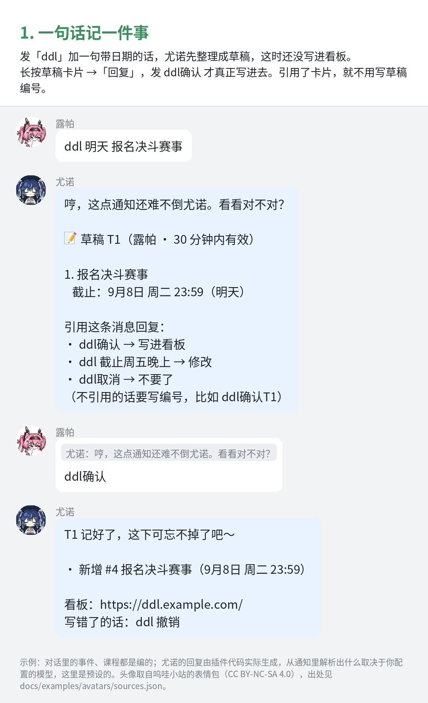
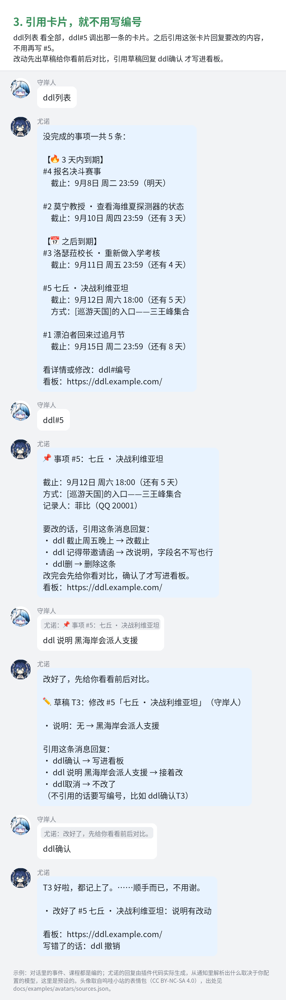

# iunoddl-kit

> 这是 `homework` 分支：插件默认只记作业（`mode` 默认是 `homework`），其余和 `main` 完全一样。想记所有有截止时间的事，用 `main` 分支，或者把配置里的 `mode` 改成 `general`。

尤诺的 DDL 小本本：GSCore 插件 IunoDDL + 公开只读的 DDL 看板（Vikunja）。

群友在 QQ 里转发通知、发一句 `ddl 明天 报名决斗赛事`，或者 @机器人，插件把它整理成草稿，本人确认后写进 Vikunja；看板网页公开只读，展示还没完成的事和时间轴。机器人默认自称「尤诺」，可以改。

QQ 机器人本身（NapCat 登录 QQ、NoneBot2、GSCore）怎么搭这里不讲，默认你已经有一个能正常回消息的 GSCore。

## 看看怎么用

**最重要的一条：引用尤诺发的卡片回复时，不用写编号；只有不引用的时候，才需要写一次编号**（草稿用 `T3`，看板上的用 `#12`）。

| 一句话记一件事 | 引用卡片，就不用写编号 |
| --- | --- |
|  |  |

- 全部 9 个场景的群聊示例：[使用示例.pdf](docs/使用示例.pdf)（也可以单独看 [docs/images](docs/images)）
- 每条指令、修改字段、两种模式、常见问题：[使用教程](docs/使用教程.md)

示例图里尤诺的每一条回复，都是用插件真实的代码生成的（生成器在 `docs/examples/make_examples.py`）。

## 两种模式和两个分支

插件有两种模式，由 `config.json` 的 `mode` 决定，详见 [插件 README](plugin/IunoDDL/README.md#两种模式)：

- `general`：记所有有截止时间、需要人去做的事（报名赛事、出征集合、商会账目、作业……），回复里叫「事项」；
- `homework`：只记作业，回复里叫「作业」「课程」，适合课程群。

两种模式都可以用 `extra_prompt` 给模型补充这个群自己的说法。

仓库有两个分支，代码完全一样，只有 `mode` 的默认值不同：

| 分支 | 默认模式 | 适合 |
| --- | --- | --- |
| `main` | `general` | 大多数人 |
| `homework` | `homework` | 只想记作业的课程群（作者自己的机器人用这个） |

用哪个分支都可以随时在配置里改 `mode`，装插件时也可以用 `install-plugin.sh --mode` 指定。

## 目录

| 路径 | 内容 |
| --- | --- |
| `plugin/IunoDDL/` | GSCore 插件，用法和配置见 [plugin/IunoDDL/README.md](plugin/IunoDDL/README.md) |
| `install-plugin.sh` | 把插件装进 GSCore 并写好配置 |
| `deploy-site.sh` | 一键部署看板：Vikunja、项目、只读分享、插件令牌、网页、nginx、证书 |
| `site/compose.yaml` | Vikunja 2.6.0 的 docker compose，域名、端口、密钥从同目录的 `.env` 读 |
| `site/vikunja_bootstrap.py` | 初始化 Vikunja：建项目、开只读分享、生成最小权限的插件令牌 |
| `site/index.html` | 看板前端模板 |
| `site/nginx/` | nginx 模板：`iunoddl-http.conf`（80 端口，申请证书用）和 `iunoddl-https.conf`（看板和后台） |
| `docs/` | 使用教程、使用示例 PDF 和示例图，以及生成示例图的脚本 |
| `tests/` | 不装 GSCore 也能跑的插件测试，说明见 [tests/README.md](tests/README.md) |

## 我们自己在用的版本

照着这些版本搭，最不容易出问题。

| 组件 | 版本 | 备注 |
| --- | --- | --- |
| 系统 | Ubuntu 24.04 LTS | 22.04 应该也行，没专门测 |
| Docker / Compose | 29.1.3 / 2.40.3 | Ubuntu 软件源里的 `docker.io` 和 `docker-compose-v2` |
| nginx | 1.24.0 | |
| certbot | 2.9.0 | |
| Vikunja | 2.6.0 | 镜像 `vikunja/vikunja:2.6.0`，SQLite |
| GSCore（gsuid_core） | 0.10.7 | Python 3.12.3。插件用到 GSCore 的 `ai_core` 和它环境里的 pydantic_ai、httpx、Pillow；记新条目时要调用模型解析通知，所以 GSCore 里要配好 AI 模型（查看、确认、撤销这些不用模型） |
| NoneBot2 | 2.5.0 | 配 nonebot-adapter-onebot 2.4.6 和 nonebot-plugin-genshinuid 6.1.1，把 QQ 消息转给 GSCore |
| NapCat | 4.18.28 | 自己打的 docker 镜像，内置 LinuxQQ 3.2.22-42941，用 OneBot v11 的 WebSocket 连 NoneBot2 |

插件没有额外的 Python 依赖，用 GSCore 环境里已有的就够。

## 配置速查

插件的配置都在 GSCore 目录下的 `data/IunoDDL/config.json`，改完下一条消息就生效。完整说明见[教程的配置一节](docs/使用教程.md#配置在哪里改)。

| 想改什么 | 改哪个字段 | 备注 |
| --- | --- | --- |
| 看板令牌 | `vikunja_token` | `deploy-site.sh` 会自动生成；手动建见方案 A 第 3 步 |
| 看板项目、视图、网址 | `project_id`、`view_id`、`board_url` | `deploy-site.sh` 会自动生成 |
| 在哪些群开放 | `allowed_groups` | 默认一个都不开 |
| 记什么（模式） | `mode` | `general` 或 `homework` |
| 给模型的补充说明 | `extra_prompt` | 写这个群自己的说法，留空就不加 |
| 机器人的名字 | `bot_name` | 默认「尤诺」 |
| 帮助图的横幅 | `data/IunoDDL/banner.jpg` | 放一张图进去就行 |
| 用哪个 AI 模型 | GSCore 自己的 AI 设置 | 插件不单独配模型 |

`mode`、`bot_name`、`board_url` 和横幅会影响帮助图，GSCore 会缓存帮助图，要重启才会重画。

## 方案 B：一键部署

准备：

- 一台 Ubuntu 服务器，有 root；
- 两个域名都解析到这台服务器，一个给看板（例如 `ddl.example.com`），一个给 Vikunja 管理后台（例如 `todo.example.com`）；
- 80 和 443 端口能从外网访问；
- 装好依赖：`sudo apt install docker.io docker-compose-v2 nginx certbot python3 openssl curl`。

然后在仓库目录里运行：

```bash
sudo ./deploy-site.sh --ddl ddl.example.com --todo todo.example.com --email you@example.com
sudo ./install-plugin.sh --gscore /path/to/gsuid_core \
    --config /opt/iunoddl-vikunja/iunoddl-config.json --groups 群号1,群号2
sudo systemctl restart gscore   # 按你自己启动 GSCore 的方式重启
```

`deploy-site.sh` 依次做这些事，哪一步出错就停在哪一步，修好后可以直接重跑：

1. 检查参数、依赖、端口，确认 nginx 里没有别的站点占用这两个域名，现有配置能通过 `nginx -t`；
2. 在 `/opt/iunoddl-vikunja` 起 Vikunja（只监听 `127.0.0.1:3456`），随机生成签名密钥写进 `.env`；
3. 用 Vikunja 的命令行建管理员 `ddladmin`，随机密码存在 `/opt/iunoddl-vikunja/admin-password`；
4. 建「DDL」项目，开一个只读、不要密码的公开分享，生成插件用的 API 令牌（只给插件用得到的权限，永不过期）；
5. 生成看板网页，放到 `/srv/www/<看板域名>`；
6. 写 nginx 的 80 端口配置，用 certbot 给两个域名申请一张证书（续期后自动重载 nginx），再写 443 端口配置。每次写完都先 `nginx -t`，检查不过就撤回，nginx 保持原样；重载后会等新配置真正生效（nginx 的重载是异步的）再往下走；
7. 生成插件配置 `/opt/iunoddl-vikunja/iunoddl-config.json`，最后从本机访问一遍看板、接口和后台。

重跑时已有的密钥、管理员、项目、分享和令牌都会沿用。常用选项（完整列表见 `./deploy-site.sh --help`）：

- `--frame-ancestors "'self' https://blog.example.com"`：允许别的网站用 iframe 嵌入看板。看板地址后面加 `?embed=1` 是去掉页头的嵌入版；
- `--skip-certbot --cert-dir 目录`：已经有证书时不再申请；
- `--port`、`--dir`、`--web-root`、`--admin`、`--project`：换端口、安装目录、网页目录、管理员用户名、项目名。

`install-plugin.sh` 把插件复制到 `gsuid_core/plugins/IunoDDL`（已有的旧版本挪到 `.iunoddl-backups/`），再把 `--config` 里的看板地址和令牌、`--groups` 等参数合并进 `data/IunoDDL/config.json`。已有的配置会保留，只覆盖这次给出的字段，所以升级插件也用它。其他参数：`--mode general|homework`、`--bot-name 名字`、`--admins QQ号`、`--private-users QQ号`。

GSCore 和看板不在同一台机器上时，把插件配置里的 `vikunja_api` 改成 `https://todo.example.com/api/v1`。

## 方案 A：手动部署

脚本跑不通，或者想自己掌控每一步时，照下面做。示例里的域名、目录、端口都换成你自己的。

**1. 起 Vikunja**

```bash
sudo mkdir -p /opt/iunoddl-vikunja/data/db /opt/iunoddl-vikunja/data/files
sudo chown 1000:1000 /opt/iunoddl-vikunja/data/db /opt/iunoddl-vikunja/data/files  # 镜像里以 uid 1000 运行
sudo cp site/compose.yaml /opt/iunoddl-vikunja/
sudo install -m 600 /dev/null /opt/iunoddl-vikunja/.env
printf 'VIKUNJA_PUBLIC_URL=https://todo.example.com/\nVIKUNJA_SECRET=%s\nVIKUNJA_PORT=3456\n' "$(openssl rand -hex 32)" \
    | sudo tee /opt/iunoddl-vikunja/.env >/dev/null
cd /opt/iunoddl-vikunja && sudo docker compose up -d
curl -s http://127.0.0.1:3456/api/v1/info   # 能看到 "version":"v2.6.0" 就是起来了
```

**2. 建管理员**（注册是关着的，只能用命令行建，会提示输入密码）

```bash
sudo docker compose exec vikunja /app/vikunja/vikunja user create -u ddladmin -e you@example.com
```

**3. 建项目、分享和令牌**，二选一：

- 用脚本：`sudo env VIKUNJA_ADMIN_PASSWORD='管理员密码' python3 site/vikunja_bootstrap.py --api http://127.0.0.1:3456/api/v1 --username ddladmin --out /opt/iunoddl-vikunja/bootstrap.json`，结果里有项目编号、视图编号、分享哈希和令牌；
- 在网页上：等第 5 步 nginx 配好后登录管理后台，
  - 新建项目「DDL」，打开后网址是 `/projects/<项目编号>/<视图编号>`，默认打开的就是「列表」视图，记下这两个数字；
  - 在项目菜单里选「共享项目」→「创建共享链接」，权限选「只读」，不设密码。生成的链接 `/share/<哈希>/auth` 里那一段就是分享哈希；
  - 「设置」→「API 令牌」→「创建令牌」，只勾这些权限：`projects_views_tasks` 的 read_all；`tasks` 的 read_one、create、update、delete；`labels` 的 read_all、create；`tasks_labels` 的 update_bulk；`tasks_comments` 的 create。过期时间选「永不过期」（令牌过期后插件就访问不了看板）。令牌只显示一次，马上抄下来。

**4. 放网页**，把模板里的四个占位符换掉：

```bash
sudo mkdir -p /srv/www/ddl.example.com/.well-known/acme-challenge
sed -e 's/__PROJECT_ID__/项目编号/g' -e 's/__VIEW_ID__/视图编号/g' -e 's/__SHARE_HASH__/分享哈希/g' \
    -e 's#__TODO_URL__#https://todo.example.com/#g' site/index.html | sudo tee /srv/www/ddl.example.com/index.html >/dev/null
```

**5. 配 nginx 和证书**。两个模板里的占位符：`__DDL_DOMAIN__`、`__TODO_DOMAIN__`、`__WEB_ROOT__`（网页目录）、`__CERT_DIR__`（证书目录）、`__VIKUNJA_PORT__`、`__FRAME_ANCESTORS__`（谁能嵌入看板，一般填 `'self'`）。

```bash
fill() {
    sed -e 's/__DDL_DOMAIN__/ddl.example.com/g' -e 's/__TODO_DOMAIN__/todo.example.com/g' \
        -e 's#__WEB_ROOT__#/srv/www/ddl.example.com#g' -e 's#__CERT_DIR__#/etc/letsencrypt/live/ddl.example.com#g' \
        -e 's/__VIKUNJA_PORT__/3456/g' -e "s/__FRAME_ANCESTORS__/'self'/g" "$1"
}
fill site/nginx/iunoddl-http.conf | sudo tee /etc/nginx/sites-available/iunoddl-http.conf >/dev/null
sudo ln -s /etc/nginx/sites-available/iunoddl-http.conf /etc/nginx/sites-enabled/
sudo nginx -t && sudo systemctl reload nginx
sudo certbot certonly --webroot -w /srv/www/ddl.example.com --cert-name ddl.example.com \
    -d ddl.example.com -d todo.example.com --deploy-hook "systemctl reload nginx"
fill site/nginx/iunoddl-https.conf | sudo tee /etc/nginx/sites-available/iunoddl-https.conf >/dev/null
sudo ln -s /etc/nginx/sites-available/iunoddl-https.conf /etc/nginx/sites-enabled/
sudo nginx -t && sudo systemctl reload nginx
```

**6. 装插件**：把 `plugin/IunoDDL` 整个复制到 `gsuid_core/plugins/` 下，重启 GSCore。第一次加载会生成 `data/IunoDDL/config.json`，把 `vikunja_token`、`project_id`、`view_id`、`board_url`、`allowed_groups` 填好就能用，改配置不用重启。每个字段的意思写在文件里的 `_说明` 和插件的 README 里。

## 安全说明

- 看板是公开的：知道网址的人都能看到所有没完成的事项，包括说明和附件。别往这个项目里放不想公开的东西。
- 插件令牌只有上面列的那几项权限，读不了别的项目，也删不了项目、改不了分享。令牌和管理员密码都在 root 才能读的文件里（权限 600），别外传。
- Vikunja 的签名密钥在 `.env` 里（权限 600），泄露了别人就能伪造登录。
- 注册默认关着，新用户只能管理员用命令行建。
- `extra_prompt` 只有能改服务器上 `config.json` 的人才能写。它接在插件自己的规则后面，通知原文仍然只当数据、不执行里面的指令；不过它毕竟会交给模型，别往里写密码之类的东西。
- 部署脚本建管理员时，密码会作为命令行参数在 `docker exec` 里出现一瞬间，同一台机器上的其他用户理论上能看到；介意的话按方案 A 第 2 步手动建。

## 测试情况

- **插件**：`tests/` 里有不装 GSCore 也能跑的自动化测试，`python3 tests/run_all.py` 一条命令跑完：基础 21 项、模式 17 项，以及作业模式下 176 项输出和 0.2.0 逐字比对。0.3.0 在作业模式下的输出和 0.2.0 一致，唯一的变化是修好了一个 bug：QQ 里记的、没写说明的条目调出卡片时，「说明」那一行会重复显示一大段描述。
- **线上**：作者自己的机器人（GSCore 0.10.7，作业模式）已经从 0.2.0 升级到 0.3.0，升级后用隔离测试桥跑了 21 项线上测试，全部通过：作业模式下原来的 15 项回归（帮助、列表、详情、起草、确认写入、撤销、AI 查询等）照常通过，不是作业的通知照样被忽略；临时把 `mode` 切到 `general`，真实的模型把「ddl 明天 办护照」整理成了截止明天的草稿，测完配置原样还原。0.2.0 时还用最小权限的令牌对 Vikunja 2.6.0 测过新建、修改、删除、撤销，越权操作都被拒绝。**通用模式在真实的模型上只测了这一句**，一条通知里有好几件事、合并转发这些情况只在替身环境里测过。
- **部署和安装脚本**：在全新的 Ubuntu 24.04 容器里按方案 B 从头跑过（docker 29.1.3、nginx 1.24.0，真的用 docker compose 起 Vikunja），包括首次部署、原样重跑、装插件；另外用替身环境测过域名被占用时停下、证书有问题时撤回 nginx 配置。
- **还没测过的**：certbot 真正申请证书（需要公网能访问的真域名，测试时用的是自签名证书和 `--skip-certbot`）；nginx 由真正的 systemd 管理（测试容器里没跑 systemd，`systemctl reload nginx` 用等价的 `nginx -s reload` 代替）。

## 已知限制

- 时区固定是 Asia/Shanghai。

## 还没做的

- 0.3.0 上线，并用真实的模型测一遍通用模式
- 回归测试补上修改、合并、删除三种草稿
- 在有真域名的服务器上实测 certbot 申请证书那一步

## 素材

本仓库里的图片素材都取自「呜哇小站」表情图鉴（<https://emoji.wuwa.games>）：

- **帮助图的图标**：尤诺表情包，15 个来自「企划/Solar5」，2 个来自「画师/雾雪」。每个图标取自哪张表情的第几帧，记在 `plugin/IunoDDL/IunoDDL/iunoddl_help/icons/sources.json`。
- **帮助图的横幅**：另外合成的。夜空、星星和月亮都是程序画的，人物取自「画师/雾雪」表情包里的「哈气」第 0 帧，原样放上去，没有缩放、裁切或改动。想换成自己的横幅，见插件 README。
- **示例图里的头像**：尤诺用帮助图的图标；其他角色的头像各取自她们的表情包，每张出自哪个包、哪一帧、怎么裁的，记在 `docs/examples/avatars/sources.json`。

该站的表情包页面标注「本文采用 CC BY-NC-SA 4.0 许可协议，转载请注明出处」，并说明站内内容**仅供个人、非商业使用**，禁止倒卖、付费分发、打包牟利或以其他方式借助它们牟利。鸣潮相关角色、名称及原作设定的权利归各自权利人所有。

示例图里的对话、事件和课程都是为了演示编的，不是游戏剧情。

## 许可证

代码按 [GPL-3.0-or-later](LICENSE) 发布，和 GSCore（gsuid_core）一致，插件直接引用了它的代码。

图片不在 GPL 范围内：上面「素材」一节里的图标、横幅、头像，以及用它们做出来的示例图和 PDF，按素材来源的 [CC BY-NC-SA 4.0](https://creativecommons.org/licenses/by-nc-sa/4.0/deed.zh-hans) 提供，使用时要注明出处、不能商用、改编后要按相同方式共享。GPL 允许商用代码，但如果你要商用，请先把这些图片换成自己有权使用的图。
